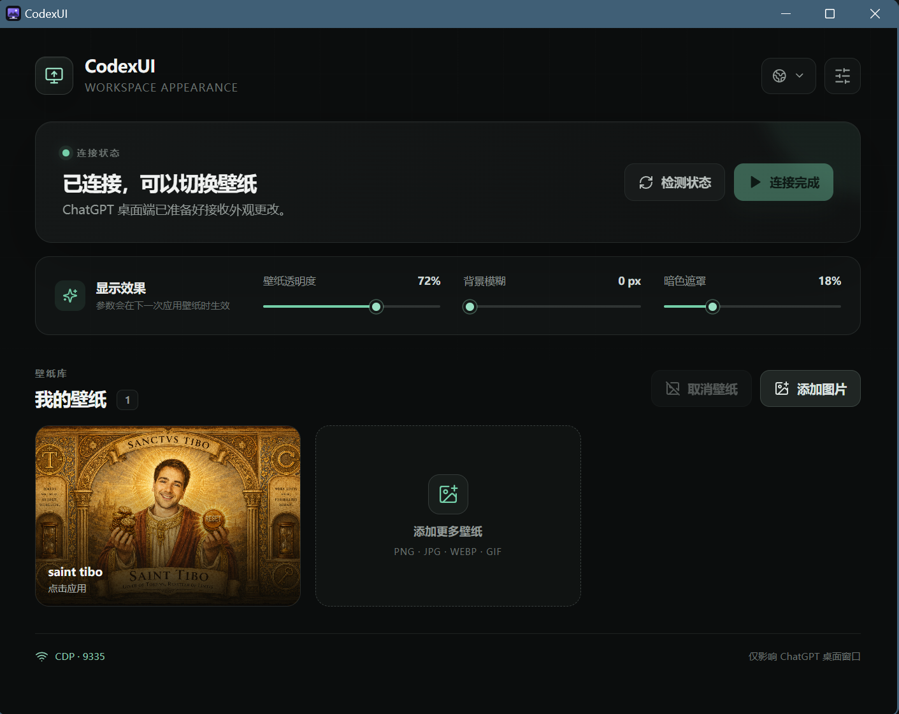
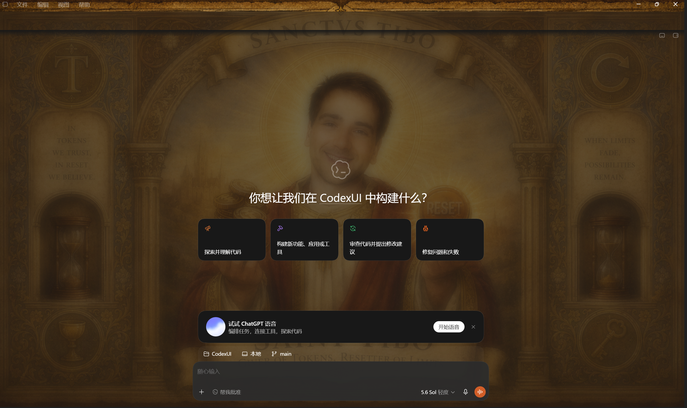

# CodexUI


CodexUI 是一款轻量、开源的 ChatGPT/Codex Desktop 本地增强工具，支持壁纸管理和完整会话迁移。它通过仅监听本机回环地址的 Chrome DevTools Protocol（CDP）向桌面客户端注入背景样式和会话右键菜单，不修改官方安装文件、应用签名或用户的原始图片。

> CodexUI 是社区项目，与 OpenAI 无隶属或背书关系。ChatGPT、Codex 和 OpenAI 是其各自所有者的商标。

## 效果展示

### 壁纸管理器



### 应用后的 Codex Desktop



## 功能

### v0.2.0：换一台电脑，继续原来的 Codex 上下文

右键会话「同步到目录」→ 同步软件 → 另一台电脑「导入会话」。自动处理 UUID、日期目录、项目路径与分页历史依赖，带走整段工作上下文。**已由用户手动完成一次真实跨电脑迁移并确认成功。** 查看 [完整更新日志](CHANGELOG.md)。

- 自动发现并启动官方 ChatGPT/Codex Desktop
- 通过本机 CDP 连接桌面客户端
- 导入、预览、切换、删除和取消壁纸
- 调节壁纸透明度、背景模糊和暗色遮罩
- 将注入严格限制在主窗口，不影响宠物等透明置顶辅助窗口
- 页面导航或重绘后自动恢复壁纸
- 所有图片均保存在本地
- 在 Codex 会话右键菜单中选择「同步到目录」「导入会话」
- 每 15 秒将选定会话及分页历史依赖写入压缩快照，通过现有同步软件传到另一台电脑
- 导入预览、本机项目目录映射、独立 UUID、历史字节偏移重算和完整性校验
- CodexUI 内提供可搜索的本机会话列表、同步状态与停止同步入口

## 安装与使用

从仓库的 **Releases** 页面下载适合系统的安装包：

- Windows：NSIS `-setup.exe` 或 MSI
- Apple Silicon Mac：`aarch64` DMG
- Intel Mac：`x86_64` DMG

使用步骤：

1. 打开 CodexUI。
2. 如果 ChatGPT/Codex 已运行，先保存正在进行的工作，然后点击“重启并连接”。
3. 点击“添加壁纸”，选择 PNG、JPG、WebP、GIF 或 BMP 图片。
4. 调整显示参数，点击图片应用；点击“取消壁纸”恢复官方外观。

Windows 使用 `127.0.0.1:9335`。壁纸复制到 `%LOCALAPPDATA%\CodexUI\wallpapers`，原始图片不会被修改。

### 跨电脑迁移会话

1. 电脑 A：在 CodexUI 连接 Codex，点击「启用 Codex 右键菜单」，右键一个本机会话，选择「同步到目录」。也可直接在 CodexUI 的会话列表选择。
2. 保持 CodexUI 运行，由你的同步软件同步生成的 `codex-session-UUID` 目录。
3. 电脑 B：运行 CodexUI，右键会话或侧栏空白处选择「导入会话」，选中同步完成的 `codex-session-UUID` 目录。
4. 选择电脑 B 上对应的项目目录，检查预览后导入。程序自动处理 UUID、日期目录、项目元数据、分页依赖和字节偏移，并通过本机 Codex app-server 注册会话。

导入创建独立副本，保留对话、工具输出、历史指令和压缩上下文。项目源码及外部图片、文件、插件与运行环境需要单独同步。同步为单向快照，不会合并两台电脑上继续编辑的聊天。详细说明见 [会话迁移与兼容性](docs/SESSION_TRANSFER.md)。

## 安全与隐私

- CDP 仅绑定 `127.0.0.1`，不会暴露到局域网。
- 开启 CDP 时，同一系统用户下的其他本地程序理论上可以访问调试端口；请勿同时运行不可信软件。
- 壁纸功能不读取聊天内容；会话迁移会读取你选择的会话及其历史依赖，并将完整对话、工具输出和历史指令保存到所选目录。
- 不复制 `auth.json`、API Key 配置、访问令牌或整个账户数据库；对话里原本存在的敏感内容会随历史一起迁移。请将迁移包视为私人数据。
- 导入不直接编辑 Codex 的 SQLite 或全局项目配置，也不覆盖已有会话。
- 仓库和 Actions workflow 不包含证书、密码或签名私钥。

## 本地开发

需要 Node.js 22+、PNPM 10+、Rust stable，以及对应平台的 [Tauri 2 系统依赖](https://v2.tauri.app/start/prerequisites/)。

```bash
pnpm install --frozen-lockfile
pnpm tauri dev
```

构建当前平台安装包：

```bash
pnpm tauri build
```

## 发布

推送形如 `v0.2.0` 的标签后，[GitHub Actions](.github/workflows/release.yml) 会自动从 `CHANGELOG.md` 提取该版本的更新说明，并行构建 Windows x64、macOS Apple Silicon 和 macOS Intel 安装包。三路构建全部成功且安装包齐全后自动公开 Release；失败时保留为草稿。应用版本应先在 `src-tauri/tauri.conf.json`、`src-tauri/Cargo.toml`、`src-tauri/Cargo.lock` 和 `package.json` 中保持一致，标签必须对应相同版本与提交。

默认构建不需要自定义密钥，只使用 GitHub 自动提供的 `GITHUB_TOKEN`。面向最终用户正式分发时，建议配置代码签名，详见 [发布签名说明](docs/CODE_SIGNING.md)。

## 贡献

欢迎提交 Issue 和 Pull Request。提交前请至少运行：

```bash
pnpm build
pnpm test
cargo test --manifest-path src-tauri/Cargo.toml --lib
cargo check --manifest-path src-tauri/Cargo.toml
```

## License

[MIT License](LICENSE)
